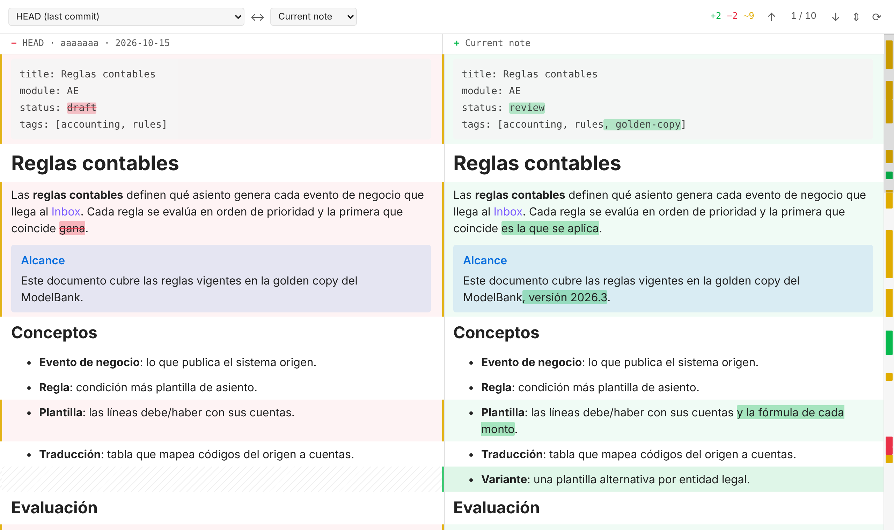
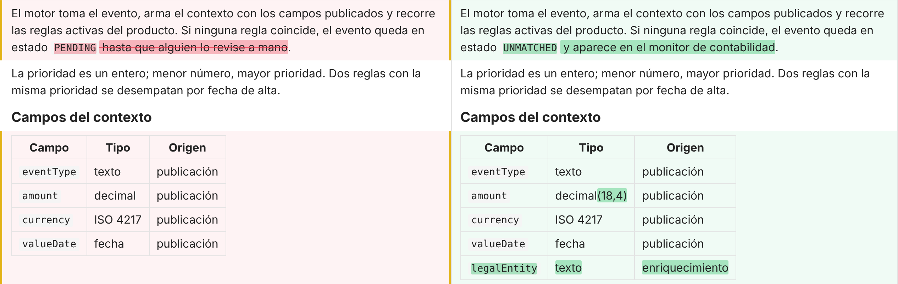
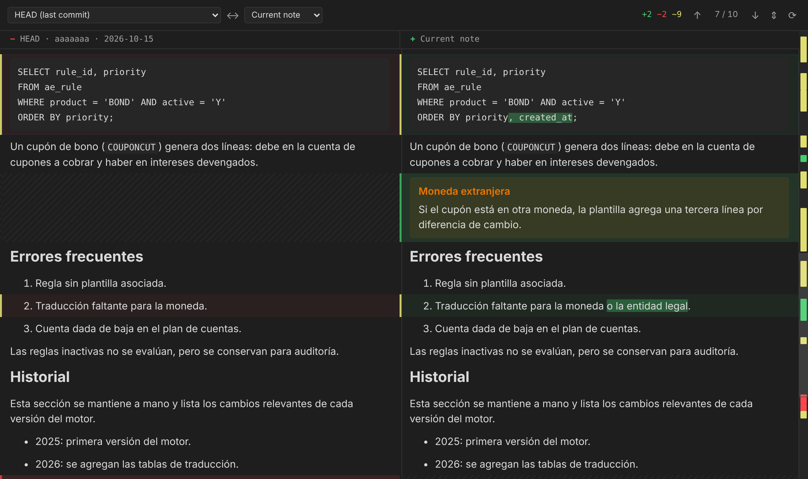

# Rendered Markdown Diff para Obsidian

[English](README.md)

Compará una nota con su historial de git, con las dos versiones **renderizadas** y lado a lado. Ves qué cambió en la nota tal como la leés, no como líneas de `+` y `−`.



A la izquierda está la versión anterior y a la derecha la nota actual. Las dos se renderizan con el renderizador de Obsidian, así que wiki-links, callouts, embeds, tablas, código, Mermaid y Dataview se ven como en la vista de lectura. Los dos lados se alinean bloque por bloque y comparten un solo scroll, así que nunca se desfasan.

## Qué hace

- **Compara contra cualquier versión**: HEAD (el último commit), lo staged (el índice) o cualquier commit que haya tocado la nota. El lado derecho puede ser la nota actual o la versión staged.
- **Muestra exactamente qué cambió**:
  - Los bloques agregados se ven en verde.
  - Los quitados, en rojo.
  - Los editados tienen un borde amarillo y adentro se resaltan las palabras que cambiaron. Funciona también en tablas, listas, callouts y el frontmatter.
- **Mapa de cambios**: una franja a la derecha muestra dónde está cada cambio y qué parte de la nota estás viendo. Hacé clic o arrastrá para moverte.
- **Salta de cambio en cambio**:
  - Con los botones ↑ ↓ de la barra.
  - Con `n` / `p` o `Alt+↓` / `Alt+↑` dentro del diff.
  - Con los comandos *Ir al siguiente cambio* e *Ir al cambio anterior*, a los que les podés asignar un atajo.
- **Mostrar solo los cambios**: pliega las tiradas largas de bloques sin cambios y deja algunos bloques de contexto alrededor de cada cambio.
- **Se actualiza solo** mientras editás la nota.
- **Links que funcionan**: los wiki-links de cualquiera de los dos lados abren la nota enlazada, y al pasar el mouse muestran la vista previa de siempre.





## Uso

Con una nota abierta, usá una de estas opciones:

- El ícono **git-compare** de la barra lateral izquierda.
- **Mostrar diff renderizado de la nota actual** desde la paleta de comandos.
- **Mostrar diff renderizado** desde el clic derecho sobre la nota o desde el menú `⋯` de la pestaña.

Después elegí en el desplegable de la izquierda contra qué versión comparar.

La nota tiene que estar dentro de un repositorio git: el vault mismo o cualquier carpeta por encima.

## Instalación

### Con BRAT

1. Instalá el plugin de la comunidad [BRAT](https://github.com/TfTHacker/obsidian42-brat).
2. Ejecutá **BRAT: Add a beta plugin for testing**.
3. Pegá `edangelo2/obsidian-rendered-markdown-diff`.
4. Activá **Rendered Markdown Diff** en **Ajustes → Complementos de la comunidad**.

BRAT además lo mantiene actualizado.

### A mano

1. Bajá `main.js`, `manifest.json` y `styles.css` de la [última versión](https://github.com/edangelo2/obsidian-rendered-markdown-diff/releases/latest).
2. Copialos en `<tu vault>/.obsidian/plugins/rendered-markdown-diff/`.
3. Recargá la lista en **Ajustes → Complementos de la comunidad** y activá **Rendered Markdown Diff**.

## Ajustes

| Ajuste | Qué hace |
|---|---|
| Comparar contra | El lado izquierdo por defecto: HEAD o staged. |
| Abrir el diff en | En una pestaña nueva o en un panel a la derecha. |
| Resaltar las palabras cambiadas | Marca las palabras exactas que cambiaron dentro de los bloques editados. |
| Mostrar solo los cambios por defecto | Abre el diff con los bloques sin cambios plegados. |
| Bloques de contexto | Cuántos bloques sin cambios quedan visibles alrededor de cada cambio al plegar. |
| Commits en la lista | Cuántos commits muestra el selector de versiones. |
| Ejecutable de git | Ruta a `git`. Dejalo vacío para buscarlo en PATH, en Homebrew o en `/usr/bin`. Obsidian abierto desde el Dock no siempre ve el PATH de tu terminal. |

## Seguridad

El plugin solo lee de git. Ejecuta `git rev-parse`, `git show` y `git log` con `execFile` (sin shell). Nunca hace stage, commit ni checkout, ni escribe nada en el repositorio. El plugin no hace pedidos de red (las imágenes de tus notas cargan como en la vista de lectura).

Funciona solo en escritorio, porque necesita ejecutar `git`.

## Cómo funciona

1. **Parte en bloques.** Cada versión se parte en bloques de nivel superior: frontmatter, títulos, párrafos, cada ítem de lista, callouts, tablas, código, matemática `$$` y comentarios `%%`.
2. **Alinea los bloques.** Un diff de secuencias alinea los bloques de las dos versiones. Dentro de cada zona con cambios, los bloques bastante parecidos (al menos 40 % en común) se emparejan como *editados*. El resto se muestra como agregado, quitado o reemplazado.
3. **Renderiza.** Cada bloque se renderiza con `MarkdownRenderer` de Obsidian. Cada fila es una grilla de dos columnas, así los dos lados comparten la altura y todo el diff scrollea junto.
4. **Resalta palabras.** En los bloques editados compara el texto ya renderizado palabra por palabra y marca solo las palabras que cambiaron. Así funciona con todo lo que produce el renderizador (links, callouts, tablas) sin volver a parsear el Markdown.

**Limitaciones:**

- Los bloques se renderizan de a uno, así que lo que depende de toda la nota (como la numeración de las notas al pie) puede verse un poco distinto que en la vista de lectura.
- Los embeds de una versión vieja muestran el contenido actual de la nota embebida.

## Desarrollo

```bash
npm ci
npm test         # partición en bloques, alineación, diff por palabra y git contra repos reales
npm run dev      # recompila main.js con cada cambio
npm run build    # chequea tipos y genera main.js
```

Para probar tu build, enlazá o copiá la carpeta en `<vault>/.obsidian/plugins/rendered-markdown-diff/`.

Para publicar una versión nueva:

1. Subí `version` en `manifest.json` y `package.json`, y agregá la versión a `versions.json`.
2. Publicala de una de estas dos formas:
   - En la pestaña **Actions**, abrí **Release** y tocá **Run workflow**.
   - Pusheá un tag con el mismo número, por ejemplo `git tag 0.2.0 && git push --tags`.

El workflow de release prueba y compila el plugin, y adjunta `main.js`, `manifest.json` y `styles.css` a la release de GitHub.

## Créditos

La idea viene de la extensión de VS Code [Markdown Diff Visualiser](https://github.com/arjuntic/markdown-diff-visualiser). Este plugin está escrito desde cero para Obsidian.

## Licencia

[MIT](LICENSE)
